<!-- README generado por generar.py a partir de perfil.json y del portafolio. Para cambiar la estructura, editar plantilla.md (no este archivo). -->

<a href="https://retana1885.github.io/proyectos2026/">
<picture>
  <source media="(prefers-color-scheme: dark)" srcset="svg/banner-oscuro.svg">
  <source media="(prefers-color-scheme: light)" srcset="svg/banner-claro.svg">
  
</picture>
</a>

Diseño, construyo y opero los sistemas internos de una cadena regional de farmacias en México: abasto e inventario, centro de distribución, integraciones con el punto de venta, capacitación del personal y reportes para Dirección. Trabajo con desarrollo asistido por IA: yo defino el problema y las reglas, y apruebo cada pantalla antes de que llegue a producción.

<picture>
  <source media="(prefers-color-scheme: dark)" srcset="svg/impacto-oscuro.svg">
  <source media="(prefers-color-scheme: light)" srcset="svg/impacto-claro.svg">
  
</picture>

<picture>
  <source media="(prefers-color-scheme: dark)" srcset="svg/ahora-oscuro.svg">
  <source media="(prefers-color-scheme: light)" srcset="svg/ahora-claro.svg">
  
</picture>

<a href="https://retana1885.github.io/proyectos2026/">
<picture>
  <source media="(prefers-color-scheme: dark)" srcset="svg/proyectos-oscuro.svg">
  <source media="(prefers-color-scheme: light)" srcset="svg/proyectos-claro.svg">
  
</picture>
</a>

<picture>
  <source media="(prefers-color-scheme: dark)" srcset="svg/principios-oscuro.svg">
  <source media="(prefers-color-scheme: light)" srcset="svg/principios-claro.svg">
  
</picture>

<picture>
  <source media="(prefers-color-scheme: dark)" srcset="svg/stack-oscuro.svg">
  <source media="(prefers-color-scheme: light)" srcset="svg/stack-claro.svg">
  
</picture>

<b>Ver los 28 proyectos del portafolio</b>

| Proyecto | Tipo | Estatus | Avance |
|---|---|---|---|
| **Academia San Camilo** | Aplicación web (PWA) / Capacitación y gamificación | Producción | 60 % |
| **Panel de Pendientes Sucursales** | Aplicación web interna / Mesa de ayuda (ticketing) | Producción | 90 % |
| **Migración del correo corporativo a Microsoft 365** | Infraestructura / Migración de correo corporativo | Producción | 90 % |
| **Salas de control** | Herramienta interna / Tablero operativo | Producción | 85 % |
| **Mapa CEDIS** | Herramienta interna / Visualización operativa de almacén | Producción | 90 % |
| **Análisis comercial y reportes ejecutivos para la Dirección** | Analítica de negocio / Reportes ejecutivos | Producción | 75 % |
| **CediMatch** | Herramienta interna / Tablero operativo y analítico | Producción | 85 % |
| **Monitor DisCon** | Herramienta interna / Monitor operativo | Producción | 88 % |
| **Canave Hub** | Portal / landing interna (herramienta interna) | Producción | 92 % |
| **XMatch** | Herramienta interna / Backend + Web | Producción | 88 % |
| **ControlStock** | Saneamiento de datos y automatización | Producción | 95 % |
| **Optimizador de Zonificación Territorial** | Aplicación web (SPA) | Producción | 95 % |
| **Probador de Teclado** | Herramienta de escritorio | Producción | 100 % |
| **ABACO** | Sistema de soporte a decisiones | Producción | 92 % |
| **CryptoBot** | Bot / Backend | En Desarrollo | 50 % |
| **Monitor de Recursos del Sistema** | Aplicación de escritorio | Producción | 95 % |
| **Dashboard de Resurtido de Stock** | Aplicación web | En Desarrollo | 80 % |
| **Canave IA** | Aplicación web | En Desarrollo | 75 % |
| **Armado de Pedidos v2** | Aplicación de escritorio | Producción | 90 % |
| **Sistema de Facturación CFDI v2** | Aplicación web | Producción | 85 % |
| **Consultor PLM** | Aplicación web | En Desarrollo | 70 % |
| **Sistema de Inventario Físico** | Aplicación web | En Desarrollo | 80 % |
| **Crawler de Documentación NovaCaja** | Herramienta CLI | Producción | 100 % |
| **Buscador de Posiciones en Almacén** | Aplicación web | Producción | 95 % |
| **Sistema de Turnos Médicos** | Aplicación de escritorio | Producción | 90 % |
| **Consolidador de Hojas de Pedido** | Aplicación de escritorio | Producción | 95 % |
| **Sistema de Facturación v1 (Legacy)** | Aplicación web | Pausado | 100 % |
| **Experto NovaCaja** | Aplicación de escritorio | Producción | 95 % |

<a href="https://retana1885.github.io/proyectos2026/"><b>Ver el portafolio completo →</b></a>

Este perfil se arma solo a partir de mi portafolio (datos al 2026-11-04). Imágenes generadas con un script propio, en versión clara y oscura; fuentes Bebas Neue y DM Mono (SIL OFL).

